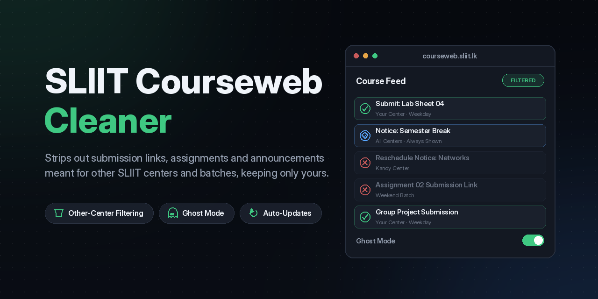

<div align="center">

  

# SLIIT CourseWeb Cleaner — Web Platform

**The official landing page, interactive showcase, and documentation portal for the [SLIIT CourseWeb Cleaner](https://github.com/dulithdivisekara/sliit-courseweb-cleaner) browser extension.**

[](https://sliit-courseweb-cleaner-web.pages.dev)
[](https://react.dev)
[](https://www.typescriptlang.org/)
[](https://vite.dev)
[](https://tailwindcss.com)
[](LICENSE)

  <br />

  <p align="center">
    <a href="https://sliit-courseweb-cleaner-web.pages.dev"><strong>Explore Live Website »</strong></a>
    &nbsp;•&nbsp;
    <a href="https://github.com/dulithdivisekara/sliit-courseweb-cleaner"><strong>View Extension Repo »</strong></a>
    &nbsp;•&nbsp;
    <a href="https://courseweb.sliit.lk"><strong>SLIIT CourseWeb »</strong></a>
  </p>

  <p align="center">
    <a href="https://chromewebstore.google.com/detail/sliit-courseweb-cleaner/lnoadlfhebmkhmbfmehdgoffjllgadjm"></a>
    <a href="https://microsoftedge.microsoft.com/addons/detail/sliit-courseweb-cleaner/gmlodfhgiopjgamoijjffcmgfenkkkhe"></a>
    <a href="https://addons.mozilla.org/en-US/firefox/addon/sliit-courseweb-cleaner/"></a>
  </p>

</div>

---

<div align="center">
  
</div>

---

## 📌 Overview

**SLIIT CourseWeb Cleaner Web** is the official web showcase designed to introduce, demonstrate, and distribute the **SLIIT CourseWeb Cleaner** browser extension.

Built for students at the Sri Lanka Institute of Information Technology (SLIIT), the web platform delivers an editorial-grade interactive experience featuring real-time browser detection, side-by-side interactive UI comparison, setup walkthroughs, and technical feature breakdowns.

### 🌟 Why This Web Experience?

- **Smart Browser Routing**: Dynamically detects whether a visitor is on Google Chrome, Brave, Microsoft Edge, or Mozilla Firefox, instantly directing them to the appropriate store listing.
- **Interactive Comparison Hub**: Allows students to toggle between the raw, cluttered default CourseWeb view and the clean, organized CourseWeb view in real-time.
- **Live Extension Tour**: Step-by-step visual onboarding highlighting the initial setup wizard, campus & batch auto-detection, and Notice Protector.
- **Comprehensive Feature Matrix**: Transparent breakdown comparing the extension against default Moodle and generic ad-blockers.

---

## 🚀 Key Features

| Feature                             | Description                                                                                                                                     |
| :---------------------------------- | :---------------------------------------------------------------------------------------------------------------------------------------------- |
| **Dynamic Browser Detection**       | User-Agent sniffing intelligently identifies Chrome, Edge, or Firefox and customizes primary CTAs accordingly.                                  |
| **Interactive Before/After Viewer** | Tabbed state switcher comparing high-contrast screenshots of the default SLIIT Moodle interface vs. the cleaned UI.                             |
| **Student Reality Benefits**        | Highlights key productivity wins: auto-hiding past semester clutter, true dark mode, instant deadline visibility, and 100% client-side privacy. |
| **Specifications Matrix**           | Side-by-side technical evaluation highlighting zero telemetry, notice protection, and cloud sync rules.                                         |
| **Onboarding Walkthrough**          | 4-step visual setup guide showcasing web store installation, initialization, campus selection, and floating settings access.                    |
| **Editorial Dark-Accented Theme**   | Bespoke design system utilizing deep midnight navy (`#081E31`), warm SLIIT gold (`#F7B924`), and off-white canvas (`#FBFBF9`).                  |
| **SEO & Social Graph Ready**        | Pre-configured OpenGraph cards, Twitter preview cards, and JSON-LD `SoftwareApplication` schema markup.                                         |

---

## 🛠️ Tech Stack & Tooling

- **Framework**: [React 19](https://react.dev/) + [TypeScript](https://www.typescriptlang.org/)
- **Build Tool**: [Vite 6](https://vite.dev/)
- **Styling**: [Tailwind CSS 3.4](https://tailwindcss.com/) + PostCSS + Autoprefixer
- **Icons**: [Lucide React](https://lucide.dev/)
- **Deployment & Hosting**: [Cloudflare Pages](https://pages.cloudflare.com/) (Edge CDN, HTTP/3, Brotli compression)
- **Code Formatting & Quality**: [Prettier](https://prettier.io/) + ESLint + TypeScript strict checks

---

## 📂 Project Architecture

```plaintext
sliit-courseweb-cleaner-web/
├── public/                     # Static production assets
│   ├── assets/                 # Icons, browser SVG logos, and UI screenshots
│   │   ├── chrome.svg          # Google Chrome brand icon
│   │   ├── edge.svg            # Microsoft Edge brand icon
│   │   ├── firefox.svg         # Mozilla Firefox brand icon
│   │   ├── after.png           # Cleaned CourseWeb interface screenshot
│   │   ├── before.png          # Cluttered default CourseWeb screenshot
│   │   ├── config-modal.png    # Setup wizard modal capture
│   │   ├── settings-tab.png    # Extension settings drawer capture
│   │   ├── step1-install.png   # Installation step 1
│   │   ├── step3-configure.png # Installation step 3
│   │   ├── step4-apply.png     # Installation step 4
│   │   ├── step5-settings-icon.png # Floating settings gear trigger
│   │   ├── testimonial-student.png # Student testimonial avatar
│   │   └── sliit-courseweb-cleaner-social-preview.png # OpenGraph card
│   └── favicon / icons         # Multi-size app favicons (16x16, 48x48, 128x128)
├── src/
│   ├── App.tsx                 # Main landing page component with all sections & state
│   ├── index.css               # Global stylesheet & Tailwind directives
│   └── main.tsx                # React DOM entry point
├── index.html                  # HTML5 template with SEO meta tags & JSON-LD
├── tailwind.config.js          # Custom color palette (navy, gold) & design tokens
├── tsconfig.json               # TypeScript configuration
├── vite.config.ts              # Vite bundler configuration
├── package.json                # Dependencies, scripts, and package metadata
├── LICENSE                     # MIT License
└── README.md                   # Project documentation
```

---

## 💻 Getting Started Locally

### Prerequisites

- **Node.js**: v18.0.0 or higher (v20+ recommended)
- **npm** or **pnpm** or **yarn**

### 1. Clone the repository

```bash
git clone https://github.com/dulithdivisekara/sliit-courseweb-cleaner-web.git
cd sliit-courseweb-cleaner-web
```

### 2. Install dependencies

```bash
npm install
```

### 3. Run the development server

```bash
npm run dev
```

Open [http://localhost:5173](http://localhost:5173) in your browser to view the application with hot module replacement (HMR).

### 4. Build for production

```bash
npm run build
```

This runs the TypeScript compiler (`tsc`) and compiles the optimized production bundle to the `dist/` directory.

### 5. Preview production build

```bash
npm run preview
```

### 6. Format codebase

```bash
npm run format
```

---

## ☁️ Cloudflare Pages Deployment

This site is deployed globally across Cloudflare's 300+ city edge network using **Cloudflare Pages**.

### Automated Deployments (Git Integration)

Every commit pushed to the `main` branch automatically triggers a fresh production build and atomic edge deployment via Cloudflare Pages:

- **Framework Preset**: Vite / React
- **Build Command**: `npm run build`
- **Build Output Directory**: `dist`
- **Node.js Version**: `22`

### Direct CLI Deployment (Wrangler / Cloudflare CLI)

You can deploy directly to Cloudflare Pages from your terminal:

```bash
# Build production bundle
npm run build

# Deploy to Cloudflare Pages via Wrangler
npx wrangler pages deploy dist --project-name=sliit-courseweb-cleaner-web

# Or deploy via Cloudflare cf CLI
cf pages deploy dist --project-name=sliit-courseweb-cleaner-web
```

---

## 🔗 Related Projects

- **[SLIIT CourseWeb Cleaner (Extension)](https://github.com/dulithdivisekara/sliit-courseweb-cleaner)**: The core open-source browser extension codebase (Manifest V3, Content Scripts, Filter Engine, and Options Page).
- **[CourseWeb Portal](https://courseweb.sliit.lk)**: The official SLIIT Moodle Learning Management System.

---

## 🤝 Contributing

Contributions, feedback, and suggestions are warmly welcomed!

1. Fork the Project
2. Create your Feature Branch (`git checkout -b feature/AmazingFeature`)
3. Commit your Changes (`git commit -m 'feat: add some AmazingFeature'`)
4. Push to the Branch (`git push origin feature/AmazingFeature`)
5. Open a Pull Request

---

## 📄 License

This project is open-source software licensed under the [MIT License](LICENSE).

---

<div align="center">
  <sub>Crafted with precision by <a href="https://dulith.me"><strong>Dulith Divisekara</strong></a>. Independent student utility not affiliated with or endorsed by SLIIT.</sub>
</div>
