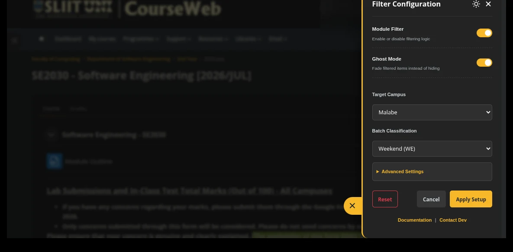
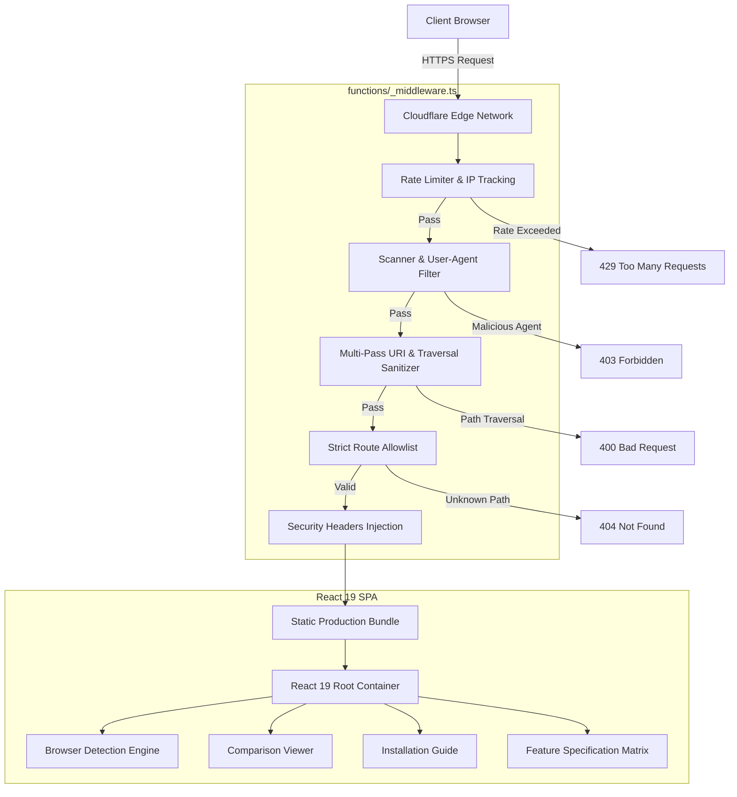
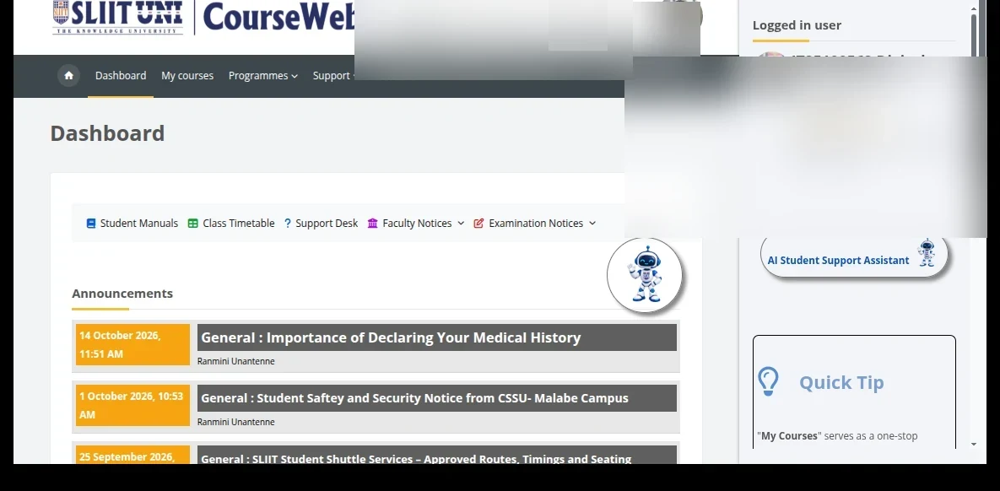
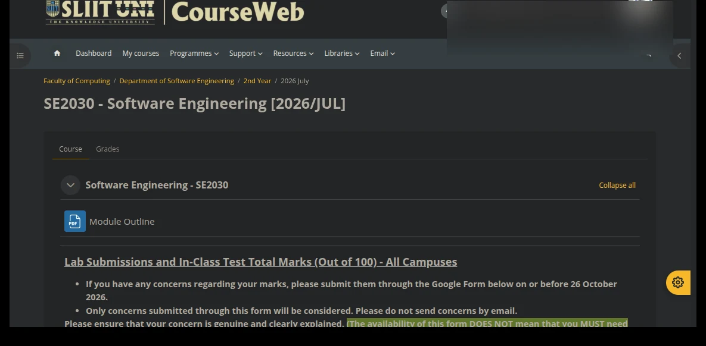

<p align="center">
  <a href="https://sliit-courseweb-cleaner.dulith.me" target="_blank" rel="noopener noreferrer">
    
  </a>
</p>

<h1 align="center">SLIIT CourseWeb Cleaner Web</h1>

<p align="center">
  Official showcase portal and distribution platform for the SLIIT CourseWeb Cleaner browser extension.
</p>

<p align="center">
  <a href="https://www.typescriptlang.org/"></a>
  <a href="https://react.dev/"></a>
  <a href="https://vite.dev/"></a>
  <a href="https://pages.cloudflare.com/"></a>
  <a href="LICENSE"></a>
</p>

<p align="center">
  <a href="#overview">Overview</a> &bull;
  <a href="#architecture--modes">Architecture</a> &bull;
  <a href="#interface-comparison">Comparison</a> &bull;
  <a href="#project-structure">Structure</a> &bull;
  <a href="#installation">Installation</a> &bull;
  <a href="#usage">Usage</a> &bull;
  <a href="#verification-tests">Testing</a> &bull;
  <a href="#edge-security--hardening">Security</a> &bull;
  <a href="#license">License</a>
</p>

---

## Overview

SLIIT CourseWeb Cleaner Web is the official showcase portal and distribution website for the [SLIIT CourseWeb Cleaner](https://github.com/dulithdivisekara/sliit-courseweb-cleaner) browser extension (v7.2.0). Designed for students at the Sri Lanka Institute of Information Technology (SLIIT), the web application demonstrates how the companion extension streamlines Moodle by eliminating visual clutter, introducing zero-latency dark mode, preserving academic notices, and customizing course navigation across 6 campuses and multiple academic intakes.

The web platform serves as an interactive product tour, cross-browser installation router, and technical documentation hub. Visitors can preview side-by-side interface transformations, inspect the slide-in side panel drawer interface, verify security guardrails, and receive direct browser-specific routing for Google Chrome, Brave, Arc, Microsoft Edge, and Mozilla Firefox.

Deployed on Cloudflare Pages, the platform incorporates edge middleware functions that deliver sub-50ms response times, automated DDoS mitigation, multi-pass URI decoding, and strict HTTP security headers.

<p align="center">
  
</p>

---

## Architecture & Modes

The project operates across two execution environments: local client-side development via Vite and production edge delivery backed by Cloudflare Pages Functions.

| Characteristic      | Local Development                      | Production Edge                                                    |
| :------------------ | :------------------------------------- | :----------------------------------------------------------------- |
| **Runtime**         | Node.js v18+ / Vite 6 Dev Server       | Cloudflare Pages Global Edge Network                               |
| **Middleware**      | Vite internal dev server               | `functions/_middleware.ts` (V8 Edge Workers)                       |
| **Asset Delivery**  | Native ESM with Hot Module Replacement | Pre-compressed static bundle (gzip/Brotli) via Cloudflare CDN      |
| **Security Layer**  | Local loopback isolation               | Bounded rate limiting, scanner blocking, multi-pass URI validation |
| **Request Latency** | ~5-15 ms (localhost)                   | <50 ms global edge response                                        |
| **Output Target**   | In-memory compilation                  | Pre-rendered static single-page application (`dist/`)              |



---

## Interface Comparison

|                                 Default Moodle Interface                                  |                                     CourseWeb Cleaner Dark Mode                                      |
| :---------------------------------------------------------------------------------------: | :--------------------------------------------------------------------------------------------------: |
|  |  |
|           Standard cluttered layout with redundant sidebars and poor contrast.            |         Focused interface with dark palette, streamlined navigation, and preserved notices.          |

---

## Project Structure

```
.
├── .github/
│   └── workflows/
│       └── ci.yml               # Automated CI workflow (build and format checks)
├── functions/
│   └── _middleware.ts           # Cloudflare Pages edge middleware (WAF, rate limiting, security headers)
├── public/
│   ├── .well-known/
│   │   └── security.txt         # RFC 9116 security policy and disclosure contacts
│   ├── assets/
│   │   ├── fonts/               # Self-hosted DM Sans variable WOFF2 fonts
│   │   ├── theme/               # Optimized WebP interface screenshots
│   │   └── icon_*.png           # Extension brand icons (16px, 48px, 128px)
│   ├── _headers                 # Cloudflare Pages HTTP security and caching headers
│   ├── _redirects               # Edge routing and canonical redirect rules
│   ├── favicon-512x512.png      # High-resolution raster brand mark
│   ├── llms.txt                 # Structured context for AI user agents
│   ├── robots.txt               # Crawler directives and bot exclusion rules
│   └── sitemap.xml              # Search engine index manifest
├── src/
│   ├── components/
│   │   ├── ComparisonViewer.tsx # Interactive before-and-after theme viewer
│   │   ├── FaqSection.tsx       # Student FAQ accordion component
│   │   ├── FeatureGrid.tsx      # Feature highlights and architectural pillars
│   │   ├── Footer.tsx           # Multi-column navigation links and credits
│   │   ├── Icons.tsx            # SVG browser icons and branding vectors
│   │   ├── InstallSteps.tsx     # 4-step onboarding walkthrough and userscript setup
│   │   ├── Navbar.tsx           # Adaptive navigation bar with theme toggle
│   │   └── SpecMatrix.tsx       # Capability comparison matrix
│   ├── App.tsx                  # Root application layout and theme provider
│   ├── index.css                # Global styles, Tailwind directives, and font declarations
│   └── main.tsx                 # React DOM mount point
├── index.html                   # HTML entry point with JSON-LD schema
├── package.json                 # Project dependencies, scripts, and metadata
├── tailwind.config.js           # Design tokens, color palette, and typography rules
├── tsconfig.json                # Strict TypeScript compiler configuration
├── vite.config.ts               # Vite bundler and chunk splitting configuration
├── LICENSE                      # MIT License
└── README.md                    # Project documentation
```

---

## Installation

### Prerequisites

- Node.js: `v18.0.0` or higher (`v20+` recommended)
- Package Manager: `npm` (bundled with Node.js) or `pnpm`

### Setup Steps

1. Clone the repository:

   ```bash
   git clone https://github.com/dulithdivisekara/sliit-courseweb-cleaner-web.git
   cd sliit-courseweb-cleaner-web
   ```

2. Install dependencies:
   ```bash
   npm install
   ```

---

## Usage

### Development Server

Run the local development server with Hot Module Replacement (HMR):

```bash
npm run dev
```

The application will be accessible at `http://localhost:5173`.

### Production Build

Compile TypeScript and generate the production distribution bundle:

```bash
npm run build
```

Production assets are emitted to the `dist/` directory.

### Preview Production Build

Preview the generated production build locally:

```bash
npm run preview
```

### Code Formatting

Enforce Prettier formatting standards across the codebase:

```bash
# Verify formatting without modification
npm run format:check

# Auto-format all project files
npm run format
```

---

## Verification Tests

Run the verification suite to ensure code quality and build integrity:

```bash
# Execute strict TypeScript type checking and bundle generation
npm run build

# Verify code formatting conformance
npm run format:check
```

Continuous integration runs automatically on every pull request and push to the `main` branch via GitHub Actions (`.github/workflows/ci.yml`).

---

## Edge Security & Hardening

The web platform executes defensive edge logic in `functions/_middleware.ts` before requests reach static assets:

- **Bounded Edge Rate Limiting**: Tracks client requests within a 60-second sliding window (600 req/min per IP) with automatic LRU pruning capped at 5,000 tracked IPs to eliminate state-exhaustion memory vulnerabilities.
- **Scanner Penalty Lockout**: Offensive probing patterns and automated recon tools (Nikto, SQLMap, WPScan, DirBuster, Acunetix, Nessus) trigger immediate temporary lockout bans.
- **Multi-Pass URI Decoding**: Protects against double-encoded directory traversal payloads (`..%252f`) and prevents unhandled `URIError` runtime exceptions.
- **HTTP Method Restriction**: Rejects modifying methods (`POST`, `PUT`, `DELETE`, `CONNECT`), permitting only read-only requests (`GET`, `HEAD`, `OPTIONS`).
- **Strict Route Enforcement**: Validates URL paths against an explicit allowlist, dropping unauthorized fuzzing attempts at the edge.
- **Defense-in-Depth Headers**: Injects hardened HTTP headers across all responses:
  - `Content-Security-Policy`: Restricts script and resource execution origins.
  - `Strict-Transport-Security`: Mandates HTTPS transport with 1-year HSTS max-age.
  - `X-Content-Type-Options: nosniff`: Prevents MIME-sniffing exploits.
  - `X-Frame-Options: DENY`: Mitigates clickjacking attacks.
  - `Cross-Origin-Opener-Policy: same-origin`: Isolates the browsing context.

---

## Session Logging & Security

- **Edge Execution Metrics**: Edge request execution, status codes, and security violation events are tracked via Cloudflare Pages Function metrics and live tail inspection:
  ```bash
  npx wrangler pages deployment tail
  ```
- **Credential Protection**: Sensitive configuration files, local environment definitions (`.env`, `.wrangler`, `*.local`), and runtime logs (`*.log`) are explicitly excluded from version control via `.gitignore`.
- **Zero Data Collection**: The web application does not collect, track, or persist student credentials, LMS session tokens, or personal identifiers.

---

## Deployment

### Edge Platform Hosting

The site is hosted globally on Cloudflare Pages at:

**`https://sliit-courseweb-cleaner.dulith.me`**

### DNS Configuration

To configure a custom domain on Cloudflare Pages, establish the following DNS record:

| Record Type | Name                      | Target                                  | Proxy Status           |
| :---------- | :------------------------ | :-------------------------------------- | :--------------------- |
| **CNAME**   | `sliit-courseweb-cleaner` | `sliit-courseweb-cleaner-web.pages.dev` | Proxied (Orange Cloud) |

### Automated Continuous Deployment

Every push to the `main` branch triggers an automated build and edge deployment:

- **Framework**: Vite / React 19
- **Build Command**: `npm run build`
- **Output Directory**: `dist`
- **Node.js Version**: `20`

### Manual Deployment via Wrangler

```bash
npm run build
npm run deploy
```

---

## Browser Extension Distribution

| Store / Platform            | Target Browsers                               | Package Link                                                                                                              |
| :-------------------------- | :-------------------------------------------- | :------------------------------------------------------------------------------------------------------------------------ |
| **Chrome Web Store**        | Google Chrome, Brave, Arc, Opera, Vivaldi     | [Chrome Extension](https://chromewebstore.google.com/detail/sliit-courseweb-cleaner/lnoadlfhebmkhmbfmehdgoffjllgadjm)     |
| **Microsoft Edge Add-ons**  | Microsoft Edge                                | [Edge Add-on](https://microsoftedge.microsoft.com/addons/detail/sliit-courseweb-cleaner/gmlodfhgiopjgamoijjffcmgfenkkkhe) |
| **Firefox Browser Add-ons** | Mozilla Firefox, LibreWolf, Floorp            | [Firefox Add-on](https://addons.mozilla.org/en-US/firefox/addon/sliit-courseweb-cleaner/)                                 |
| **Tampermonkey Userscript** | Safari (via Userscripts), Orion, Kiwi Browser | [Userscript Guide](https://github.com/dulithdivisekara/sliit-courseweb-cleaner/blob/main/USERSCRIPT_INSTALL.md)           |

---

## License

This project is open-source software licensed under the [MIT License](LICENSE).

<p align="center">
  <sub>Authored by <a href="https://dulith.me">Dulith Divisekara</a>. Independent student utility not affiliated with or endorsed by SLIIT.</sub>
</p>
