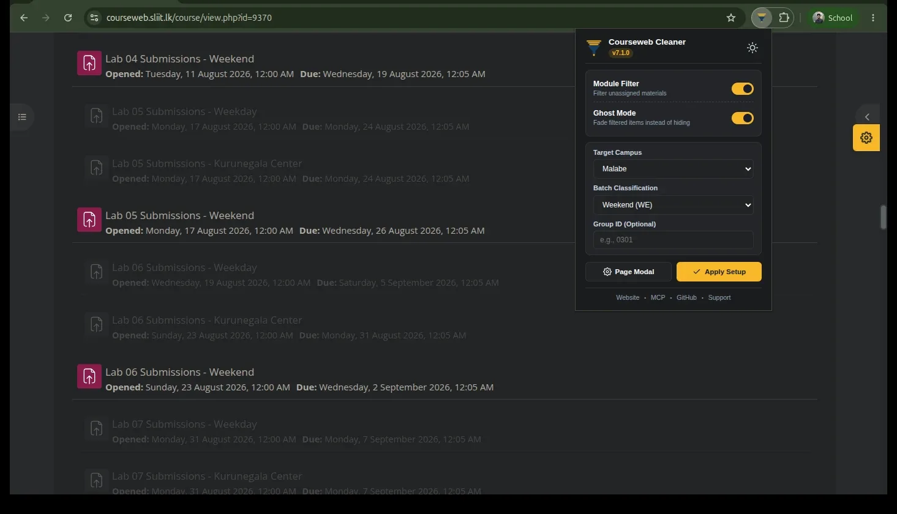
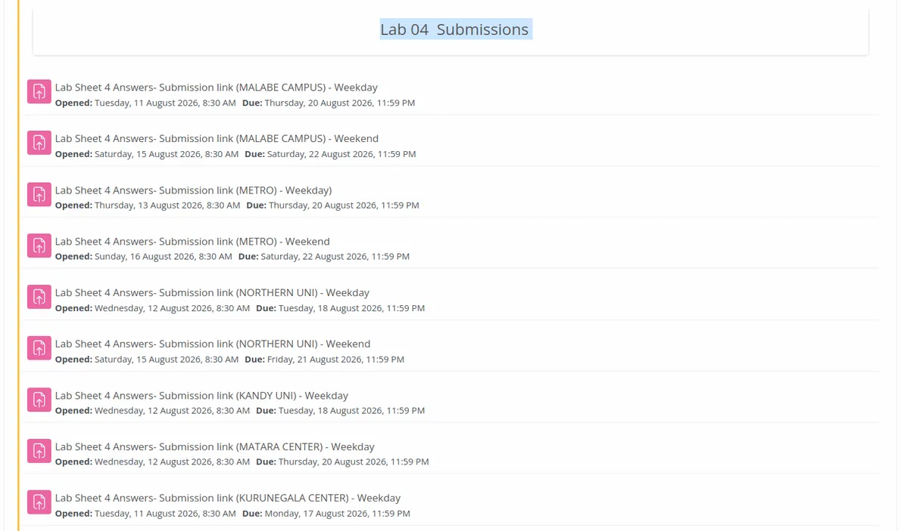
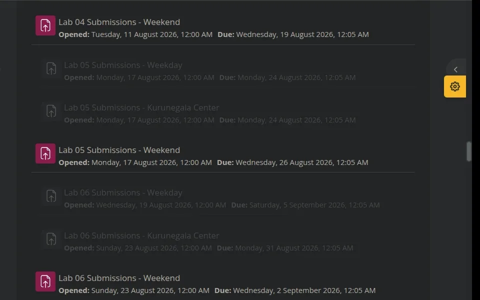
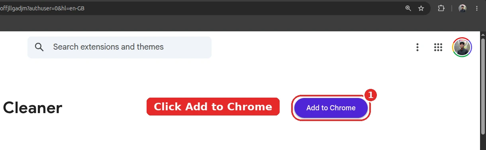
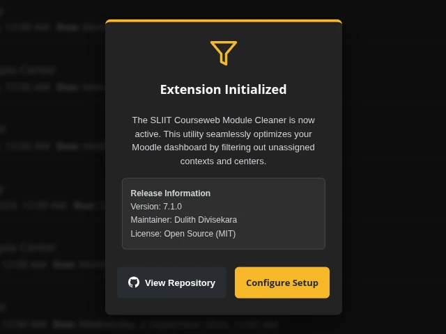
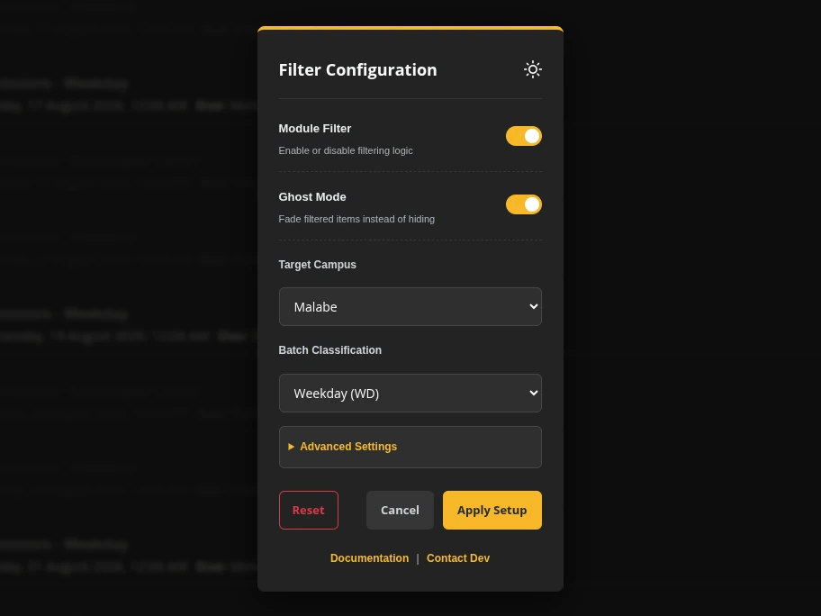
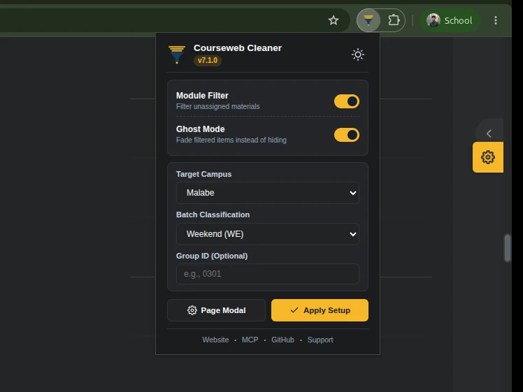

<div align="center">

  

# SLIIT CourseWeb Cleaner: Web Platform

**The official showcase portal and documentation site for the [SLIIT CourseWeb Cleaner](https://github.com/dulithdivisekara/sliit-courseweb-cleaner) browser extension.**

[](https://github.com/dulithdivisekara/sliit-courseweb-cleaner/blob/main/CHANGELOG.md)
[](https://courseweb-cleaner.dulith.me)
[](https://courseweb-cleaner.dulith.me)
[](https://react.dev)
[](https://www.typescriptlang.org/)
[](https://vite.dev)
[](https://tailwindcss.com)
[](LICENSE)

  <br />

  <p align="center">
    <a href="https://courseweb-cleaner.dulith.me"><strong>Explore Live Website</strong></a>
    &nbsp;&bull;&nbsp;
    <a href="https://github.com/dulithdivisekara/sliit-courseweb-cleaner"><strong>View Extension Repository</strong></a>
    &nbsp;&bull;&nbsp;
    <a href="https://courseweb.sliit.lk"><strong>SLIIT CourseWeb</strong></a>
  </p>

  <p align="center">
    <a href="https://chromewebstore.google.com/detail/sliit-courseweb-cleaner/lnoadlfhebmkhmbfmehdgoffjllgadjm"></a>
    <a href="https://microsoftedge.microsoft.com/addons/detail/sliit-courseweb-cleaner/gmlodfhgiopjgamoijjffcmgfenkkkhe"></a>
    <a href="https://addons.mozilla.org/en-US/firefox/addon/sliit-courseweb-cleaner/"></a>
    <a href="https://github.com/dulithdivisekara/sliit-courseweb-cleaner/blob/main/USERSCRIPT_INSTALL.md"></a>
  </p>

</div>

---

<div align="center">
  
</div>

---

## Overview

**SLIIT CourseWeb Cleaner Web** is the official showcase portal and distribution platform for the **SLIIT CourseWeb Cleaner** browser extension.

Built specifically for students at the Sri Lanka Institute of Information Technology (SLIIT), the web application delivers a responsive, privacy-first interface featuring:

- **Interactive Before and After Comparison**: Visual demonstration contrasting standard Moodle clutter against the clean, focused CourseWeb layout with dark mode support.
- **Dynamic Browser Detection**: Automatic user-agent routing for Google Chrome, Brave, Arc, Microsoft Edge, and Mozilla Firefox with direct store links.
- **Onboarding Walkthrough**: Step-by-step visual guide detailing store installation, setup wizard configuration, campus selection, and floating settings controls.
- **Notice Protector Verification**: Explains how critical exam timetables, postponement notices, and lab reschedule alerts are safeguarded.
- **Red-Team Hardened Edge Architecture**: Cloudflare Pages Functions middleware with multi-pass decoding, URI path validation, IP rate limiting, crawler filtering, and strict HTTP security headers.

---

## Interface Comparison

<table>
  <tr>
    <td width="50%" align="center">
      <strong>Without Cleaner (Default Clutter)</strong><br />
      
    </td>
    <td width="50%" align="center">
      <strong>With Cleaner (Optimized Interface)</strong><br />
      
    </td>
  </tr>
</table>

---

## Quick Setup Walkthrough

<table>
  <tr>
    <td width="25%" align="center">
      <strong>01. Add to Browser</strong><br />
      
    </td>
    <td width="25%" align="center">
      <strong>02. Open CourseWeb</strong><br />
      
    </td>
    <td width="25%" align="center">
      <strong>03. Configure Campus</strong><br />
      
    </td>
    <td width="25%" align="center">
      <strong>04. Manage Anytime</strong><br />
      
    </td>
  </tr>
</table>

---

## Key Features

| Feature                          | Description                                                                                             |
| :------------------------------- | :------------------------------------------------------------------------------------------------------ |
| **Interactive Before and After** | Side-by-side comparison illustrating filtered vs unfiltered states across light and dark themes.        |
| **Dynamic Browser Detection**    | User-agent inspection routes visitors to the matching store listing for Chrome, Edge, or Firefox.       |
| **Specification Matrix**         | Detailed comparison analyzing CourseWeb Cleaner against standard Moodle and generic ad-blockers.        |
| **Self-Hosted Variable Fonts**   | Self-hosted DM Sans font files in WOFF2 format to eliminate external font render-blocking latency.      |
| **Adaptive Theme Sync**          | Full light and dark mode system with automatic OS preference sync and manual override persistence.      |
| **Structured Data & SEO**        | Comprehensive OpenGraph cards, Twitter cards, JSON-LD schemas, sitemap, and `llms.txt` for AI crawlers. |
| **Edge Defense Middleware**      | In-depth request inspection, bounded memory rate limiting, traversal defense, and security headers.     |

---

## Tech Stack and Architecture

- **Framework**: [React 19](https://react.dev/) with [TypeScript 5.7](https://www.typescriptlang.org/)
- **Build Tool**: [Vite 6](https://vite.dev/)
- **Styling**: [Tailwind CSS 3.4](https://tailwindcss.com/) with PostCSS and Autoprefixer
- **Icons**: [Lucide React](https://lucide.dev/) and vector SVGs
- **Edge Runtime**: [Cloudflare Pages](https://pages.cloudflare.com/) with Pages Functions
- **Fonts**: Self-hosted DM Sans variable fonts (WOFF2)
- **CI / CD**: Automated GitHub Actions workflow and Cloudflare Pages git integration

---

## Project Structure

```plaintext
sliit-courseweb-cleaner-web/
├── .github/
│   └── workflows/
│       └── ci.yml               # GitHub Actions CI workflow (build & format checks)
├── functions/
│   └── _middleware.ts           # Cloudflare Pages edge security middleware (WAF, rate limits, headers)
├── public/                      # Static production assets
│   ├── _headers                 # Cloudflare Pages security & caching headers
│   ├── .well-known/
│   │   └── security.txt         # RFC 9116 security policy and disclosure contacts
│   ├── assets/
│   │   ├── fonts/               # Self-hosted DM Sans variable WOFF2 fonts
│   │   ├── theme/               # Optimized WebP screenshots (hero, before/after, steps)
│   │   └── icon_*.png           # Extension brand icons
│   ├── llms.txt                 # Structured documentation for AI user agents
│   ├── robots.txt               # Crawler instructions and scanner bot blocking
│   └── sitemap.xml              # Search engine index sitemap
├── src/
│   ├── components/
│   │   ├── ComparisonViewer.tsx # Before and after view switcher
│   │   ├── FaqSection.tsx       # Student questions and answers accordion
│   │   ├── FeatureGrid.tsx      # Feature highlights and architectural pillars
│   │   ├── Footer.tsx           # Multi-column footer with project links
│   │   ├── Icons.tsx            # SVG browser icons and branding vectors
│   │   ├── InstallSteps.tsx     # 4-step visual setup walkthrough and Tampermonkey guide
│   │   ├── Navbar.tsx           # Adaptive navigation bar with theme toggle
│   │   └── SpecMatrix.tsx       # Technical capability comparison table
│   ├── App.tsx                  # Root application layout and theme provider
│   ├── index.css                # Global styles, font declarations, and Tailwind directives
│   └── main.tsx                 # React DOM mount point
├── index.html                   # HTML entry point with SEO metadata and JSON-LD
├── tailwind.config.js           # Design tokens, palette, and typography rules
├── tsconfig.json                # Strict TypeScript configuration
├── vite.config.ts               # Vite bundler configuration
├── package.json                 # Project dependencies, scripts, and metadata
├── LICENSE                      # MIT License
└── README.md                    # Project documentation
```

---

## Edge Security and Hardening

The web platform includes an edge middleware layer in `functions/_middleware.ts` running on Cloudflare Pages:

- **Bounded Edge Rate Limiting**: Tracks client IPs within a bounded sliding window (120 req/min), preventing memory exhaustion attacks while blocking malicious flood traffic.
- **Scanner Penalty Lockout**: Offensive vulnerability probes and recon fuzzers incur a temporary penalty ban.
- **Multi-Pass URI Decoding**: Protects against double-encoded directory traversal payloads (`..%252f`) and prevents unhandled `URIError` exceptions.
- **HTTP Method Whitelist**: Restricts incoming requests to safe read-only methods (`GET`, `HEAD`, `OPTIONS`), rejecting `POST`, `PUT`, `DELETE`, and `CONNECT` attempts.
- **Offensive Scanner Blocking**: Filters automated scanners (Nikto, SQLMap, WPScan, DirBuster, Acunetix, Nessus) at the edge.
- **Strict Route Allowlist**: Drops unknown path fuzzing and brute-force directory discovery before reaching static storage.
- **Defense-in-Depth Headers**: Enforces Content Security Policy (`default-src 'self'`), `Strict-Transport-Security`, `X-Frame-Options: DENY`, `X-Content-Type-Options: nosniff`, and `Cross-Origin-Opener-Policy: same-origin`.

---

## Local Development

### Prerequisites

- **Node.js**: v18.0.0 or higher (v20+ recommended)
- **npm** or **pnpm** or **yarn**

### 1. Clone the repository

```bash
git clone https://github.com/dulithdivisekara/sliit-courseweb-cleaner-web.git
cd sliit-courseweb-cleaner-web
```

### 2. Install dependencies

```bash
npm install
```

### 3. Start development server

```bash
npm run dev
```

Open [http://localhost:5173](http://localhost:5173) in your browser to view the application with Hot Module Replacement (HMR).

### 4. Build for production

```bash
npm run build
```

Compiles TypeScript and generates the production distribution bundle in `dist/`.

### 5. Format codebase

```bash
npm run format
```

---

## Deployment and Custom Domain

### Custom Domain

The site is hosted at:

**`https://courseweb-cleaner.dulith.me`**

### DNS Configuration

To route your custom domain to Cloudflare Pages:

| Type      | Name                | Content                                 | Proxy Status           |
| :-------- | :------------------ | :-------------------------------------- | :--------------------- |
| **CNAME** | `courseweb-cleaner` | `sliit-courseweb-cleaner-web.pages.dev` | Proxied (Orange Cloud) |

### Automated Continuous Deployment

Every push to the `main` branch of `dulithdivisekara/sliit-courseweb-cleaner-web` triggers an automated Cloudflare Pages build and edge release:

- **Framework**: Vite / React
- **Build Command**: `npm run build`
- **Output Directory**: `dist`
- **Node.js Version**: `20`

### GitHub CLI Publishing

```bash
# Push latest changes to main branch
git push origin main

# Update repository metadata and homepage URL
gh repo edit dulithdivisekara/sliit-courseweb-cleaner-web --homepage "https://courseweb-cleaner.dulith.me"
```

### Cloudflare Wrangler Deployment

```bash
# Optional manual deployment via Wrangler CLI
npm run build
npx wrangler pages deploy dist --project-name=sliit-courseweb-cleaner-web
```

---

## Related Projects

- **[SLIIT CourseWeb Cleaner Extension](https://github.com/dulithdivisekara/sliit-courseweb-cleaner)**: Core browser extension repository (Manifest V3, content scripts, filter algorithms, options page).
- **[Official SLIIT CourseWeb](https://courseweb.sliit.lk)**: Official Moodle Learning Management System for SLIIT.

---

## Contributing

Contributions, feedback, and issue reports are welcome:

1. Fork the repository
2. Create your feature branch (`git checkout -b feature/improvement`)
3. Commit your changes (`git commit -m 'feat: add improvement'`)
4. Push to the branch (`git push origin feature/improvement`)
5. Open a Pull Request

---

## License

This project is open-source software licensed under the [MIT License](LICENSE).

<div align="center">
  <sub>Authored by <a href="https://dulith.me"><strong>Dulith Divisekara</strong></a>. Independent student utility not affiliated with or endorsed by SLIIT.</sub>
</div>
